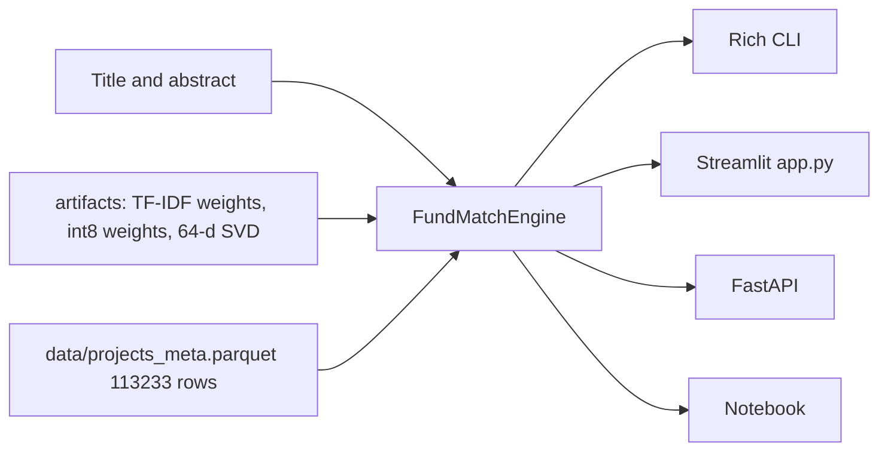

# Architecture

One process loads the exported classifier and the project table. The CLI, Streamlit app, API and notebook all call that engine. Nothing in the request path writes the user’s abstract.

## Memory and latency

The design target is a warm query under 150 ms and a loaded process under 650 MB, so it can sit in a Streamlit Community Cloud container.

- Council weights stay float64 for logit parity, with an int8 copy (0.78 MB on disk) for the optional path.
- Abstract vectors stay int8 on disk. Rows are reconstructed to float32 once (about 29 MB) so a query is one matrix-vector product.
- Lexical TF-IDF is fit on title, department and scheme at startup and then `malloc_trim` returns the temporary buffers.
- Conformal quantiles, the novelty reference (2,000 floats) and the 2D map (a 64×2 projection plus landmarks) are small files, not a second copy of the corpus.

## Retrieval

Semantic score: cosine in the 64-d SVD space of abstracts. Lexical score: cosine of a TF-IDF vector over title, department and scheme. Reciprocal rank fusion is `1/(60+rank_semantic) + 1/(60+rank_lexical)`. Each neighbour also lists the overlapping lexical terms.

## Conformal sets and novelty

See `MODEL_CARD.md`. The displayed sets follow the published test profile. The title-sample quantiles are computed and stored, and they are not pretended to be the original test coverage.

The 2D constellation is PCA on a stratified sample of the 64-d rows. A query and its 30 nearest projects use that same projection. Council centroids are means of the landmarks, not a new embedding model.

## Course map

| Lecture | Where it shows up |
| --- | --- |
| L1 | sklearn-style vectoriser settings, grouped split described in the training notes |
| L2 | TF-IDF, cleaning, the SVD map |
| L3 | Not used |
| L4 | Temperature scaling, linear token attributions, this deployment |
| L5 | Word and bigram logistic regression |
| L6 | MiniLM and BGE were measured and not deployed |
| L7 | Linear SVM was measured and not deployed, because it has no probabilities |
| L8 | int8 weights, the memory budget, the confidence gate |

## Student tools (v3)

`src/fundmatch/student.py` sits on the same engine. Topics, trends, readiness, fusion, and the starter pack do not add a second model and do not call an external API. Persona text changes the coaching and the twelve-week outline. It does not change the classifier.

## Proposal Studio (v5)

`src/fundmatch/insights.py` reuses the loaded engine; it adds no model and no index. `reliability` reads `accuracy_by_confidence` from `model_info.json`; `decision_drivers` divides `explain_council` contributions by the temperature; `abstract_checklist` is rule-based and shows its evidence; `keyword_radar` counts terms in the 50 nearest funded titles and reads the council coefficient; `compare_two` runs two analyses and compares their unit vectors in the 64-d SVD map; `filter_precedents` is a pure filter; `pdf_brief` imports fpdf2 lazily. The styling is one CSS file, `src/fundmatch/assets/neon.css`, with no JavaScript.

## What is not in the request path

Retraining, calling the GtR API, and storing user text. `src/fundmatch/pipeline/` documents how the collection and the training were done. The running service loads the export.
